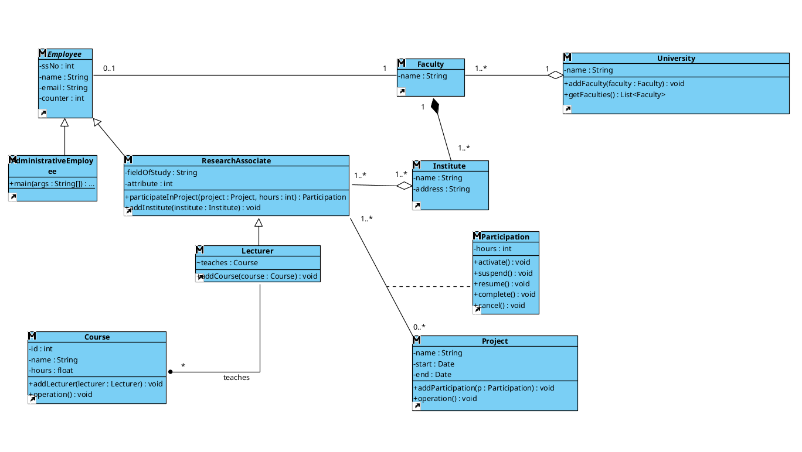
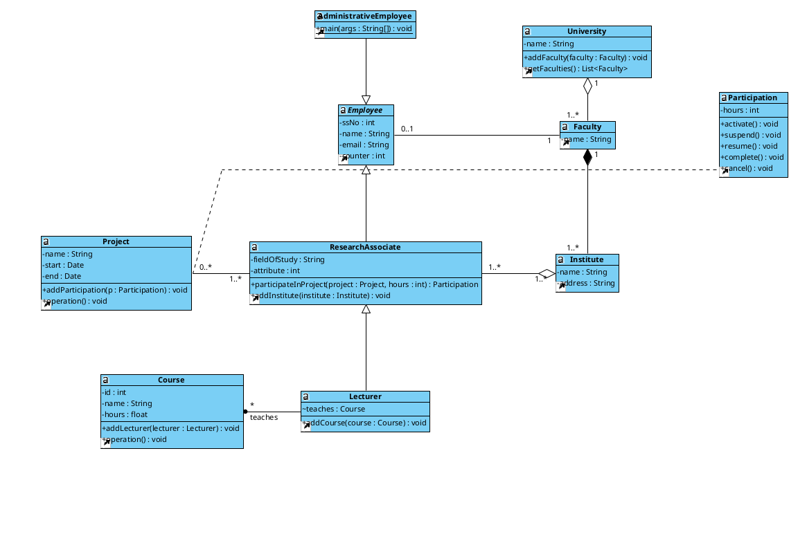
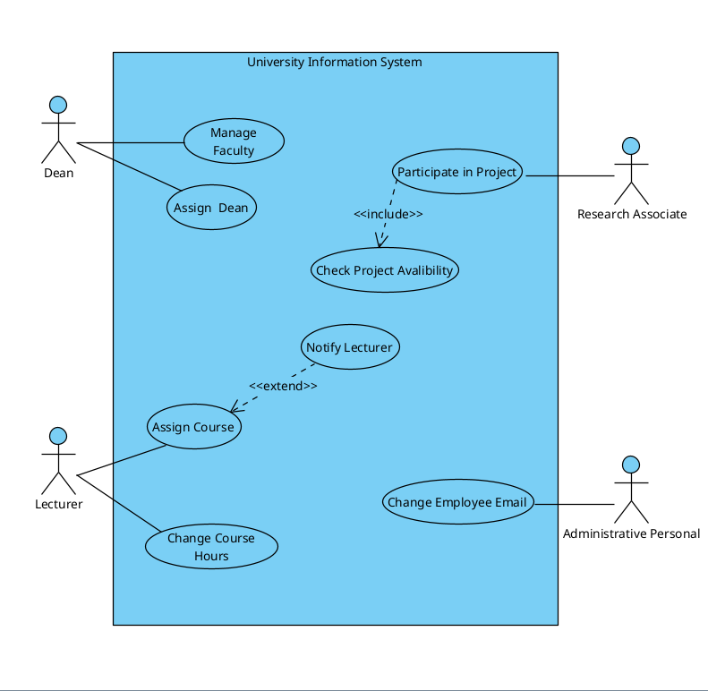
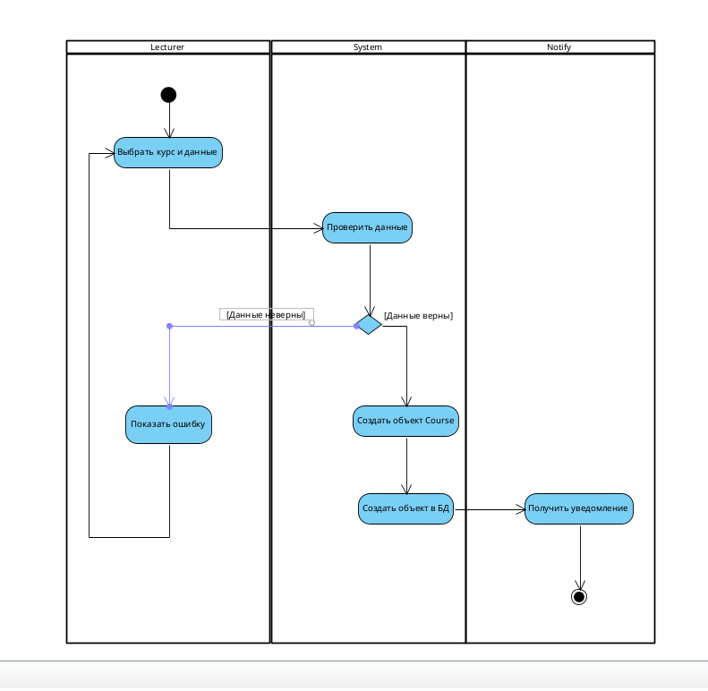
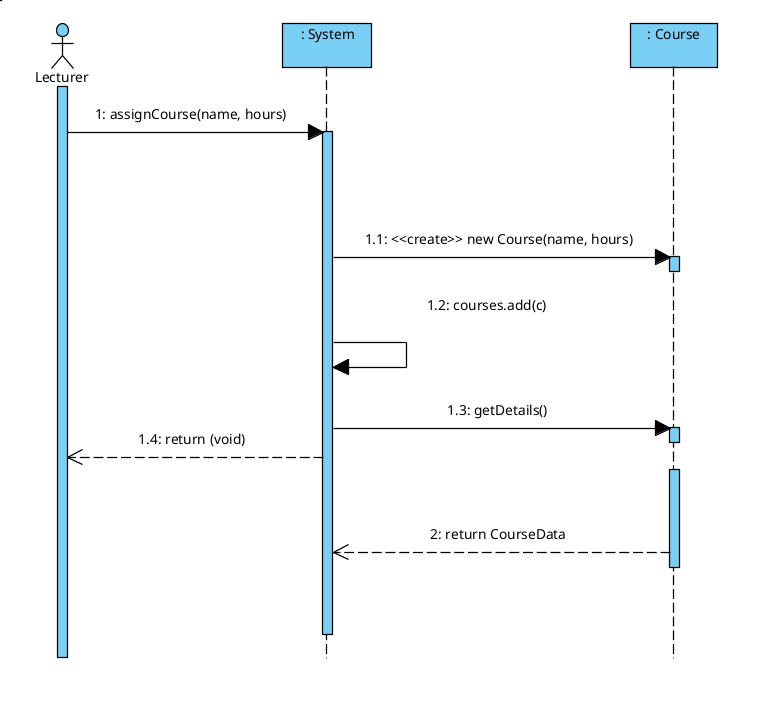

# Лабораторная работа 10. UML-моделирование и реинжиниринг

**Тема:** Университетская информационная система
**Выполнил:** Горбов Д. А. Группа 10

## Описание проекта
В рамках работы была спроектирована объектная модель университетской информационной системы, сгенерирован исходный код на Java, проведен реинжиниринг и построены поведенческие UML-диаграммы.

## Структура репозитория
- `/src` (или корень) — исходный код на Java.
- `/LabFiles` (или просто картинки в корне) — UML-диаграммы (Классов, Прецедентов, Активностей, Последовательностей).
- `/LabImages` — скриншоты успешного выполнения программы.

## UML Диаграммы
1. **Class Diagram** (Диаграмма классов) — отображает структуру системы, наследование (Employee -> ResearchAssociate -> Lecturer) и связи (композиция, агрегация).

2. **Use Case Diagram** (Диаграмма прецедентов) — показывает роли (Dean, Lecturer, Research Associate, Admin) и их цели.

3. **Activity Diagram** (Диаграмма активностей) — алгоритм назначения курса с использованием дорожек (Swimlanes).

4. **Sequence Diagram** (Диаграмма последовательностей) — сценарий вызова метода `assignCourse` с созданием объекта Course.

## Как запустить
1. Скомпилируйте все `.java` файлы.
2. Запустите класс `AdministrativeEmployee.java`.